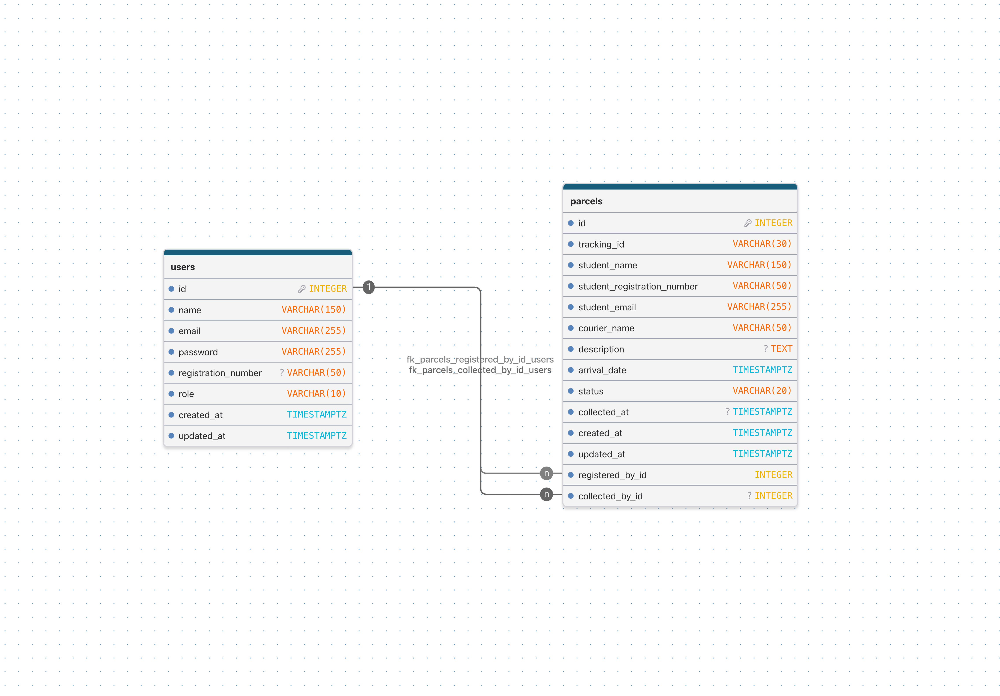

# 📦 UniCrate — AP Project (DBMS)
 
**The database design work for UniCrate, a digital parcel management system for a university campus.**
 
This repository holds the DBMS part of the project: normalization, ER diagram, relational schema, and the SQL queries the application uses. The application itself lives in the main repo, and everything here follows it.
 
| Repo | Link |
|---|---|
| Main application (source of truth) | [Maxx2016s/UniCrate](https://github.com/Maxx2016s/UniCrate) |
| DBMS work (this repo) | [Maxx2016s/UniCrate_AP_2026](https://github.com/Maxx2016s/UniCrate_AP_2026) |
 
## 🎯 About UniCrate
 
UniCrate replaces the manual parcel register at a university with a digital system.
 
- Staff register incoming parcels, update parcel records, and mark parcels as collected.
- Students can see only the parcels that carry their own registration number.
- Every parcel gets a unique tracking ID, for example `UC-20261119-A7F3K2`.
| Role | Permissions |
|---|---|
| ADMIN | Create accounts, assign roles, and manage parcels (only role that can delete a parcel) |
| EDITOR | Register and manage parcels, and create VIEWER accounts |
| VIEWER | View parcels associated with their own registration number |
 
## 🗂️ Repository Structure
 
```
UniCrate_AP_2026/
├── README.md
├── .gitignore
└── dbms/
    ├── 01_normalization.md
    ├── 02_er_diagram.png
    ├── 03_schema.sql
    └── 04_queries.sql
```
 
| File | Checkpoint | What it contains |
|---|---|---|
| `dbms/01_normalization.md` | CP1 | Explanation of 1NF, 2NF, 3NF and BCNF for the UniCrate tables, and the denormalized columns we kept on purpose |
| `dbms/02_er_diagram.png` | CP2 | ER diagram of the database |
| `dbms/03_schema.sql` | CP2 | PostgreSQL `CREATE TABLE` statements with keys, constraints and indexes |
| `dbms/04_queries.sql` | CP3 | Every query the application uses, written as SQL with JOINs where possible, each marked `READ` or `WRITE` |
 
Query timings and execution plans (CP4) will be added as `dbms/05_query_timings.md` and `dbms/plans/`.
 
## 🗄️ Database Design
 
UniCrate has two tables.
 

 
| Table | Purpose |
|---|---|
| `users` | Staff (ADMIN, EDITOR) and students (VIEWER) who can log in |
| `parcels` | One row per parcel that arrives at the university |
 
A parcel points to `users` twice:
 
- `registered_by_id` is the staff member who registered the parcel.
- `collected_by_id` is the staff member who marked it collected. It stays empty while the parcel is `PENDING`.
Some rules the schema enforces, because the application already enforces them:
 
- A VIEWER account must have a registration number.
- A `COLLECTED` parcel must have `collected_at` and `collected_by_id`. A `PENDING` parcel must have neither.
- Emails and registration numbers follow the same format the application accepts.
### How this relates to the main repo
 
The live application stores its data in **MongoDB Atlas** through **Prisma** (see `backend/prisma/schema.prisma` in the main repo). The SQL in this repo is the relational form of the same two models, `User` and `Parcel`. The differences come only from moving from MongoDB to SQL:
 
- MongoDB's `ObjectId` becomes an integer identity column.
- Prisma enums (`Role`, `ParcelStatus`) become `VARCHAR` columns with `CHECK` constraints.
- camelCase field names become snake_case column names.
## ▶️ Trying the Schema
 
The schema is written for PostgreSQL.
 
```bash
# create an empty database and load the schema
createdb unicrate
psql -d unicrate -f dbms/03_schema.sql
```
 
The tables are created in a schema called `unicrate`. To use them in a `psql` session:
 
```sql
SET search_path TO unicrate;
```
 
`dbms/04_queries.sql` is a reference file, not a script to run from start to finish. Every `?` in it marks a value that the application supplies (the queries are parameterized and never built from strings), so replace the `?` marks with real values before running a single query by hand.
 
## 🛠️ Tech Stack (main application)
 
| Technology | Purpose |
|---|---|
| Node.js + Express.js | Backend and REST APIs |
| MongoDB Atlas + Prisma ORM | Database and data access |
| JWT + bcryptjs | Authentication and password hashing |
| HTML, CSS, JavaScript | Frontend served by Express |
 
